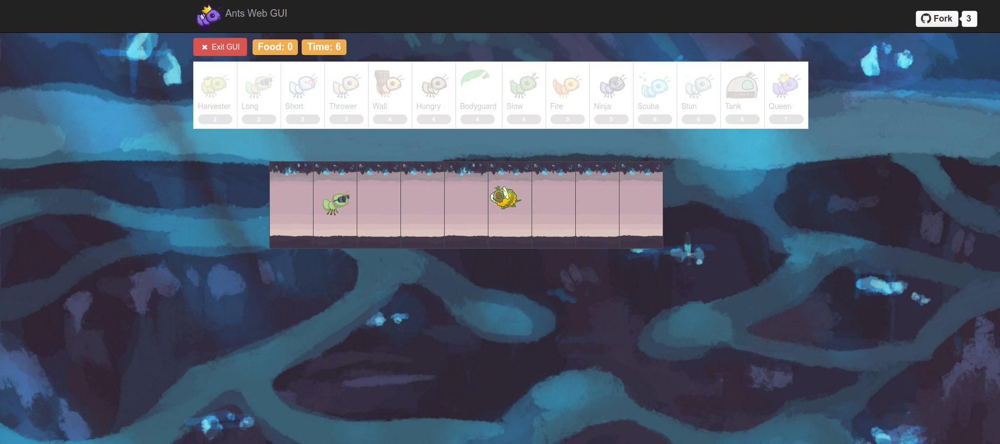

# Ants Vs. SomeBees



### 1. Introduction

This project involves creating a **tower defense** game called **Ants Vs. SomeBees**. As the ant queen, you populate your colony with the bravest ants you can muster. Your ants must protect their queen from the bees that invade your territory. Irritate the bees enough by throwing leaves at them, and they will be vanquished. Fail to pester the airborne intruders adequately, and your queen will succumb to the bees' wrath. This game is inspired by PopCap Games' [Plants Vs. Zombies].

### 2. The Game

A game of Ants Vs. SomeBees consists of a series of turns. In each turn, new bees may enter the ant colony. Then, new ants are placed to defend their colony. Finally, all insects (ants, then bees) take individual actions. Bees either try to move toward the end of the tunnel or sting ants in their way. Ants perform a different action depending on their type, such as collecting more food or throwing leaves at the bees. The game ends either when a bee reaches the end of a tunnel (you lose), or the entire bee fleet has been vanquished (you win).

### 3. Files

Files in this project:

* `ants/ants.py`: Game logic for Ants Vs. SomeBees
* `ants/ants_text.py`: Text-based game interface
* `ants/gui.py`: Graphical game interface
* `ants/utils.py`: Utilities for the game interface
* `ants/ucb.py`: Utility functions for CS 61A
* `assets` and `img`: Images and other resources used by the game and GUI
* `tests`: Project tests

### 4. Playing the Game

The game can be run in two modes: as a text-based game or using a graphical user interface (GUI). The game logic is the same in either case, but the GUI enforces a turn time limit that makes playing the game more exciting. The text-based interface is provided for debugging and development.

To start a text-based game, run:

```sh
python3 ants/ants_text.py
```

To start the graphical game, run:

```sh
python3 ants/gui.py
```

The text interface supports these options:

```text
usage: ants_text.py [-h] [-d DIFFICULTY] [-w] [--food FOOD]

Play Ants vs. SomeBees

optional arguments:
  -h, --help     show this help message and exit
  -d DIFFICULTY  sets difficulty (test/easy/medium/hard/extra-hard)
  -w, --water    loads a full layout with water
  --food FOOD    number of food to start with when testing
```
